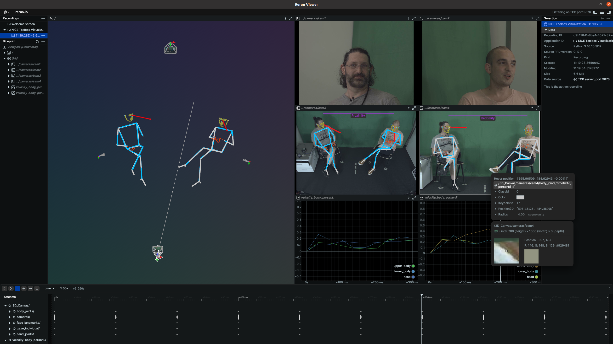

# Getting Started

```{contents} Contents
:depth: 2
:local:
```

This guide shows how to run NICE Toolbox on the example dataset. It assumes that you have successfully completed the [installation procedure](installation.md).

## Start the Terminal

The first step in working with NICE Toolbox is to open a terminal. All commands in this guide are typed into it. Follow the instructions for your operating system to open a terminal window.

**Windows**

Open the NICE Toolbox folder and double-click `start_windows.bat`. A terminal window opens, ready for the next steps.

Alternatively, open the **Start** menu, type `Terminal`, press **Enter**, and run the following commands, replacing the path with the location of your NICE Toolbox folder:

```powershell
cd "C:\path\to\nicetoolbox"
envs\nicetoolbox\Scripts\activate
```

:::{note}
If you see an error saying that **"running scripts is disabled on this system"**, run the following command once and then try again:
```powershell
Set-ExecutionPolicy -Scope CurrentUser RemoteSigned
```
For more information, see the [official Microsoft documentation](https://learn.microsoft.com/en-us/powershell/module/microsoft.powershell.security/set-executionpolicy?view=powershell-7.6).
:::

**Linux**

Open a terminal and run the following commands, replacing the path with the location of your NICE Toolbox folder:

```bash
cd "/path/to/nicetoolbox"
source envs/nicetoolbox/bin/activate
```

## Run Detectors

Detectors are algorithms that extract information from the input data. For example, they can recognize body poses, gaze directions or speech in videos. To run them on the example dataset, type:

```bash
run_detectors
```

The terminal shows the progress. Depending on your graphics card and the number of installed detectors, this can take a while. When the run is finished, the results are saved in the `outputs` folder, which is located next to the NICE Toolbox folder:

```text
outputs/experiments/<today's date>/communication_multiview_sequence_xyz_s0_l-1
```

Inside the results folder, you will find a subfolder for each type of result (for example `body_joints`) with videos showing what the detectors found, and a `_csv_files` folder with all results as tables.

If a detector fails, NICE Toolbox shows the error in the terminal. By default, it skips the failed detector and continues with the others. Detectors that you haven't installed, or that require a [Hugging Face access token](installation.md#hugging-face-access-token) you haven't set are skipped as well. The full report of the run, including all errors, is saved in the `nicetoolbox.log` file inside the `outputs/experiments/<today's date>` folder.

To select which detectors run, process only a part of the video, or change detector parameters, see the [configure detectors tutorial](tutorials/tutorial1_configure_detectors.md).

## Visualize Results

NICE Toolbox includes an interactive 3D viewer that shows all results together on top of the videos. To open it, type in the same terminal:

```bash
run_visualization
```

A window opens that looks similar to this:



You can play the video, move through the frames, and rotate and zoom the 3D view with your mouse. To learn more, see the [visualization tutorial](tutorials/tutorial4_rerun_visualization.md).

```{tip}
By default, the viewer shows the results produced **today**. To view results from another day, open `configs/visualizer_config.toml` in a text editor, find the line starting with `experiment_folder` and replace `<yyyymmdd>` with the date of the folder you want to see, e.g. `20261029`. For all viewer settings, see [visualizer config](wikis/wiki_config_files.md#visualizer-config).
```

## Run Evaluation

The evaluation calculates quality metrics for the detector results, for example how stable the detected body proportions are over time. To run it on today's results, type:

```bash
run_evaluation
```

The reports are saved in the `outputs/experiments/<today's date>_eval` folder, together with the log file `evaluation.log`. To learn how to select metrics and read the reports, see the [evaluation tutorial](tutorials/tutorial5_evaluation.md) and the [overview of available metrics](wikis/wiki_evaluation_metrics.md).

## Next Steps

To learn how to configure detectors, start with the [configure detectors tutorial](tutorials/tutorial1_configure_detectors.md). To learn how to work with your own data, see [other tutorials](tutorials/index.rst) and the [configuration wiki](wikis/wiki_config_files.md).
