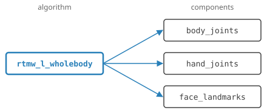
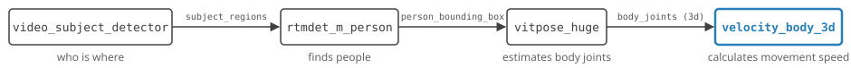

# 1. Configure Detectors

This tutorial explains the core concepts of NICE Toolbox with the `communication_multiview` example dataset. It also shows how to change the most common settings.

Before you start, complete the [installation](../installation.md) and the [getting started](../getting_started.md) guide.

```{contents} Contents
:depth: 2
:local:
```

## 1. Config Files

NICE Toolbox keeps all settings in config files in the `configs` folder inside the NICE Toolbox folder. The two files you will use most are:

| File | What it defines |
|------|-----------------|
| `configs/detectors_run_file.toml` | **What to run**: which algorithms, on which videos and frames, and where to save the results |
| `configs/detectors_config.toml` | **How each algorithm works**: its parameters, which cameras it uses, and which other algorithms it takes input from |

The config files are plain text files in the [TOML](https://toml.io) format. You can open them with any text editor, for example Notepad on Windows or Text Editor on Ubuntu. A few rules are enough to edit them:

```toml
# Lines starting with "#" are comments and are ignored
visualize = true                      # true / false switch
experiment_name = "my_experiment"     # text in quotes
algorithms = ["vitpose_huge", "spiga"] # list in square brackets, separated by commas
```

```{tip}
Before you change a config file, make a copy of it. If something stops working, you can always restore the original version.
```

## 2. Select Frames to Process

Processing a full video can take a long time. While you test settings, it is much faster to process only a short part of it.

Open `configs/detectors_run_file.toml` and find the `[run]` section:

```toml
[run]
[run.communication_multiview]
sequences = [
   {sequence_id = "sequence_xyz", video_start = 0, video_length = -1}  # Note: -1 for full video length
]
```

Each entry in `sequences` selects one video (`sequence_id`) and the part of it to process:

- `video_start` is the first frame to process. `0` is the beginning of the video.
- `video_length` is the number of frames to process. `-1` means until the end of the video.

For example, to process only the first 15 frames, change the entry to:

```toml
sequences = [
   {sequence_id = "sequence_xyz", video_start = 0, video_length = 15}
]
```

Instead of frame numbers, you can also use timestamps in the format `HH:MM:SS` or `HH:MM:SS.mmm`. For example, to process 20 seconds starting at 1 minute:

```toml
sequences = [
   {sequence_id = "sequence_xyz", video_start = "00:01:00", video_length = "00:00:20"}
]
```

To process several parts of a video, or several videos, add more entries to the list. NICE Toolbox processes the entries one after another.

## 3. Algorithms and Components

NICE Toolbox organizes its results into **components** and **algorithms**:

- A **component** is a type of result, for example `body_joints` (body poses), `gaze_individual` (gaze directions) or `emotion_individual` (facial emotions).
- An **algorithm** is a method that produces one or more components. For example, `vitpose_huge` and `rtmpose_l_aic` are two different algorithms that both produce `body_joints` components.

Some algorithms can produce multiple components. For example, `rtmw_l_wholebody` produces `body_joints`, `hand_joints` and `face_landmarks`:



You can find an overview of all components in the [components wiki](../wikis/wiki_components.md) and of all algorithms in the [algorithms wiki](../wikis/wiki_algorithms.md).

### Select Algorithms

The `algorithms` list in `configs/detectors_run_file.toml` defines which algorithms run. By default, it contains all available algorithms:

```toml
algorithms = [
   "video_subject_detector",  # subject identity system
   "rtmdet_m_person", # person detection
   "rtmw_l_wholebody", "vitpose_huge",  # body keypoints
   # ...
]
```

To run fewer algorithms, remove them from the list. Before you remove an algorithm, read [Dependencies Between Algorithms](#4-dependencies-between-algorithms): other algorithms may need its results.

### Change Algorithm Parameters

The parameters of each algorithm are in `configs/detectors_config.toml`. Each algorithm has its own section that starts with `[algorithms.<name>]`. For example:

```toml
[algorithms.gaze_distance_3d]
algorithm_type = "gaze_distance_3d"
used_keypoints = ["nose"]   # mean of these body joints
threshold_look_at = 0.4     # in absolute units (meters)
visualize = true
```

Change the value and save the file. NICE Toolbox uses the new value the next time you run the detectors. The comments next to the parameters explain what they do. The [algorithms wiki](../wikis/wiki_algorithms.md) has more details.

Some algorithms get their parameters from a shared template. See [Templates](#templates).

## 4. Dependencies Between Algorithms

Many algorithms also use the components of other algorithms as their input. For example, to calculate how fast people move, `velocity_body_3d` needs the 3D body joints from `vitpose_huge`, which in turn needs the person bounding boxes from `rtmdet_m_person`:



NICE Toolbox automatically runs the algorithms in the right order. However, it does not add missing algorithms for you. If you select an algorithm, you also need to select all algorithms it depends on. For example, to run only movement speed, select the whole chain:

```toml
algorithms = [
   "video_subject_detector",
   "rtmdet_m_person",
   "vitpose_huge",
   "velocity_body_3d",
]
```

### Fix Missing Dependencies

If you remove an algorithm that another selected algorithm depends on, NICE Toolbox stops processing the video. It shows an error like this in the terminal and the log file:

```text
Missing dependencies in detector configuration: rtmdet_m_person -> vitpose_huge.
```

This means that `vitpose_huge` needs `rtmdet_m_person`, which is not in the list. Add the missing algorithm and run again.

To see which algorithms an algorithm depends on, open `configs/detectors_config.toml`, find the algorithm, and look at its `inputs` section. Each input names the `algorithm` it comes from:

```toml
[algorithms.velocity_body_3d.inputs]
pose_3d = { component = "body_joints", algorithm = "vitpose_huge", npz_key = "3d" }
```

Some algorithms define their inputs in a shared [template](#templates) instead. In this case, look for the `template` line of the algorithm and check the inputs of that template.

## 5. Results and Experiments

Each run saves its results in an **experiment folder**. Inside it, NICE Toolbox creates one folder for each processed video, and inside that, one folder for each component:

```
outputs/experiments/<experiment_name>/
└── communication_multiview_sequence_xyz_s0_l15/   # one folder per video
    ├── body_joints/                               # one folder per component
    │   ├── vitpose_huge.npz                       # results of one algorithm
    │   └── vitpose_huge/visualization/            # videos of what it detected
    ├── ...
    ├── _csv_files/                                # all results as tables
    └── _native_outputs/                           # raw model output
```

The video folder name contains the [selected frames](#2-select-frames-to-process). For example, `video_start = 0` and `video_length = 15` give the folder `communication_multiview_sequence_xyz_s0_l15`.

### Name the Experiment

By default, the experiment folder is `outputs/experiments/<today's date>`, next to the NICE Toolbox folder. The `[io]` section of `configs/detectors_run_file.toml` defines this:

```toml
[io]
experiment_name = "<yyyymmdd>"
out_folder = "<output_folder_path>/experiments/<experiment_name>"
```

Values in angle brackets are **placeholders**. NICE Toolbox replaces them automatically: `<yyyymmdd>` becomes today's date, and `<output_folder_path>` becomes the `outputs` folder.

- **To give an experiment a name**, change `experiment_name`, for example to `"first_test"`. The results are then saved in `outputs/experiments/first_test`.
- **To save all results somewhere else**, for example on another drive, open `nice_project.toml` in the NICE Toolbox folder and change `output_folder_path`, for example to `'D:/nicetoolbox_outputs'`.

All runs with the same experiment name use the same experiment folder. If you run the detectors twice with the same name (for example, twice on the same day), NICE Toolbox replaces the results of the algorithms that run again. [Reuse Results of an Earlier Run](#reuse-results-of-an-earlier-run) uses this to save time.

For all placeholders and output settings, see the [config files wiki](../wikis/wiki_config_files.md#placeholders).

## 6. Speed Up Runs

### Disable Visualizations

By default, NICE Toolbox saves a video for each algorithm that shows what it detected. Creating these videos takes time and disk space. To disable them for all algorithms, set in `configs/detectors_run_file.toml`:

```toml
visualize = false
```

To disable them for a single algorithm only, set `visualize = false` in the algorithm's section in `configs/detectors_config.toml`. NICE Toolbox creates visualizations only when both settings are `true`.

### Disable CSV Export

At the end of each run, NICE Toolbox also saves all results as tables in the `_csv_files` folder. If you don't need them, set in the run file:

```toml
save_csv = false
```

### Reuse Results of an Earlier Run

When you change settings and run again, you often do not need to repeat all the work. Two settings in the run file let NICE Toolbox reuse the results in the same [experiment folder](#5-results-and-experiments).

**Skip algorithms that already ran.** If you have already run an algorithm and only want to run the algorithms that use its results, remove it from the `algorithms` list and set:

```toml
check_missing_detectors_dependencies = false
```

NICE Toolbox then reads the results of the missing algorithms from the earlier run.

**Repeat only the post-processing.** Algorithms based on large models, such as `vitpose_huge` or `spiga`, run in two steps:

1. The model analyzes the video. This is the slowest step.
2. The algorithm post-processes the raw model output. For example, it filters, smooths or triangulates it to 3D.

Many parameters, such as `min_detection_confidence` or `filter_keypoints`, only affect the post-processing. To try different values without analyzing the video again, set:

```toml
skip_inference = true
```

NICE Toolbox then reuses the raw model output from the `_native_outputs` folder. This only works if the same algorithms have already run on the same frames in this folder. Afterwards, set it to `false` again.

## 7. Advanced Configuration

### Add a Custom Algorithm Instance

You can add custom algorithm instances and run them next to the existing ones. For example, `body_distance_3d` calculates the distance between people from the body joints of `vitpose_huge`. To calculate the same distance from the body joints of `sam_3d_body_dinov3` instead, add a new section to `configs/detectors_config.toml`:

```toml
[algorithms.body_distance_3d_sam]
algorithm_type = "body_distance_3d"
used_keypoints = ["nose"]
visualize = true
[algorithms.body_distance_3d_sam.inputs]
pose_3d = { component = "body_joints", algorithm = "sam_3d_body_dinov3", npz_key = "3d" }
```

Then add the new name and the algorithms it depends on to the `algorithms` list in the run file:

```toml
algorithms = [
   "video_subject_detector",
   "rtmdet_m_person",
   "vitpose_huge",
   "body_distance_3d",
   "sam_3d_body_dinov3",
   "body_distance_3d_sam",
]
```

Both instances run side by side. NICE Toolbox saves their results under their own names, so you can compare them directly. When you copy an existing section, also copy its `inputs` and `required_assets` sections, if it has them.

### Templates

Many algorithms share their parameters through a **template**. For example, all body joint algorithms use `mmpose_2d_template`:

```toml
[templates.mmpose_2d_template]
min_detection_confidence = 0.5  # discard keypoints with low confidence
...

[algorithms.vitpose_huge]
template = "mmpose_2d_template"
components = ["body_joints"]
...
```

A parameter changed in a template applies to all algorithms that use it. To change it for a single algorithm only, add the parameter to that algorithm's section. Values in the algorithm's section always replace the values from the template:

```toml
[algorithms.vitpose_huge]
template = "mmpose_2d_template"
components = ["body_joints"]
min_detection_confidence = 0.3  # used instead of 0.5 from the template
```

### Handle Errors

By default, if an algorithm fails, NICE Toolbox logs the error, skips this algorithm, and continues with the others. You can change this with `error_level` in the run file:

| Value | Behavior |
|-------|----------|
| `"DETECTOR"` | Skip the failed algorithm and continue with the others (default) |
| `"SEQUENCE"` | Skip the whole video and continue with the next one |
| `"STRICT"` | Stop at the first error |

To get more detailed messages in the log file, for example when reporting a problem, set `log_level = "DEBUG"`.

### Keep Several Run Files

Instead of editing `detectors_run_file.toml` again and again, you can keep several run files, for example a short test run and a full run. Copy the file, for example to `configs/test_run.toml`, change it, and start it with:

```bash
run_detectors --run_config configs/test_run.toml
```

## Next Steps

- To run NICE Toolbox on your own videos, see [include your own dataset](tutorial2_include_dataset.md).
- For a full reference of all settings, see the [config files wiki](../wikis/wiki_config_files.md).
