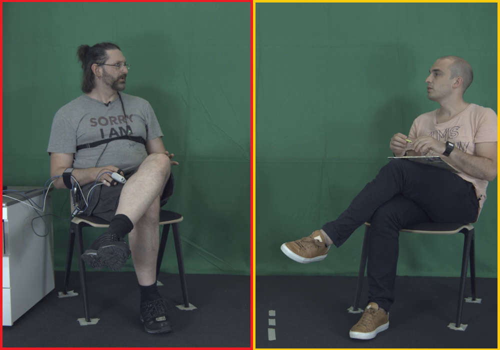
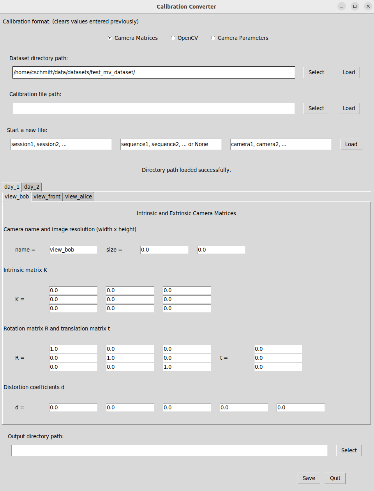
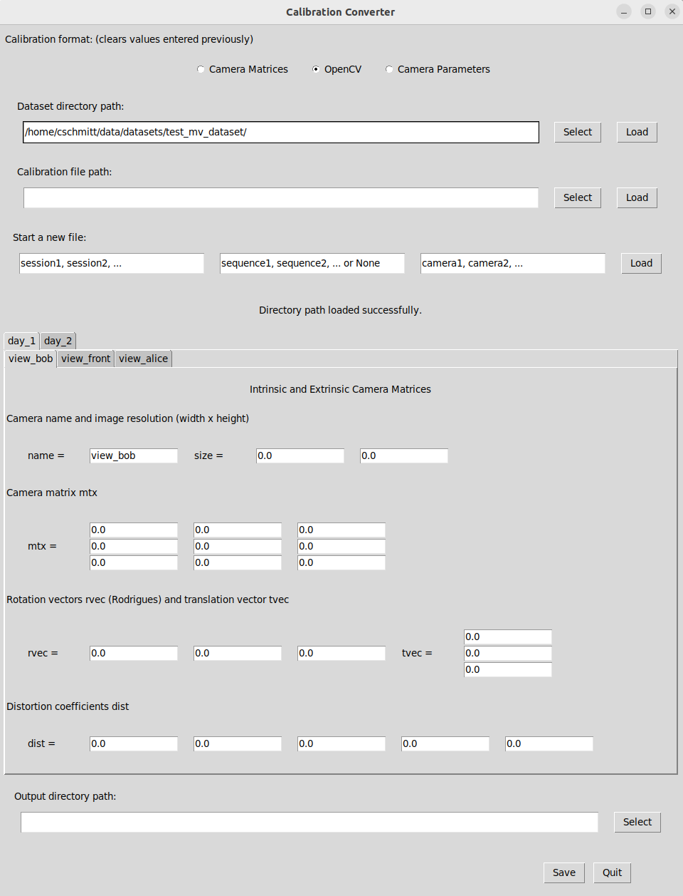

# 2. Configure Custom Dataset

This tutorial shows how to run NICE Toolbox on a custom dataset. It explains how to describe single view and multiview recordings, audio tracks, and the subjects in them.

Before you start, complete the [configure detectors](tutorial1_configure_detectors.md) tutorial. This tutorial uses the run file, the algorithms list and the experiment folder from it.

```{contents} Contents
:depth: 2
:local:
```

## 1. Dataset Properties

NICE Toolbox reads your dataset from a description in `configs/dataset_properties.toml`. For each recording, this description gives the path to the video file of each camera, and optionally to audio files. It also gives each person in the recording a name and defines how to tell the people apart.

A dataset consists of **sequences**. A sequence is one recording, for example one session of two people talking. Each sequence has a unique name, the `sequence_id`.

Your video and audio files do not need a fixed folder layout. NICE Toolbox is very flexible and can adapt to many different folder structures.

## 2. Single View Dataset

### Organize the Files

In this example, the dataset `test_dataset` has three recordings. In each recording, one camera films two people who sit next to each other and talk:

```text
datasets/
└── test_dataset/
    ├── sequence_1/
    │   └── view_1.mp4
    ├── sequence_2/
    │   └── view_1.mp4
    └── sequence_3/
        └── view_1.mp4
```

Put the dataset folder into the datasets folder of your project. You find its path as `datasets_folder_path` in `nice_project.toml` in the NICE Toolbox folder.

### Describe the Dataset

Open `configs/dataset_properties.toml` and add a new block for your dataset:

```toml
[test_dataset]
sequences = [
    {sequence_id = "sequence_1"},
    {sequence_id = "sequence_2"},
    {sequence_id = "sequence_3"},
]

[test_dataset.template]
dataset_root = "<datasets_folder_path>/test_dataset"
data_input_folder = "<dataset_root>/<sequence_id>"
path_to_calibrations = ""  # no camera calibration
subjects = ["person_left", "person_right"]

[test_dataset.template.video.cameras]
view_1.path = "<data_input_folder>/view_1.mp4"
view_1.subjects.rule = "vsplit"  # split the image into a left and a right half
view_1.subjects.order = ["person_left", "person_right"]
```

The block has three parts:

- `sequences` lists the recordings. Each entry needs at least a unique `sequence_id`.
- `template` contains the settings that all sequences share. NICE Toolbox copies them into each sequence.
- `template.video.cameras` defines the cameras. Each camera has a name that you select, here `view_1`.

Values in angle brackets are placeholders:

- `<datasets_folder_path>` comes from `nice_project.toml`.
- `<sequence_id>` becomes the `sequence_id` of each sequence. So for `sequence_2`, `data_input_folder` becomes `.../test_dataset/sequence_2`.

```{tip}
If the video file names differ between sequences, for example because they contain the recording date, use a `*` wildcard: `"<data_input_folder>/camera_1/*.mp4"`. It must match exactly one file.
```

### Assign People to the Camera

All results of NICE Toolbox belong to a named subject. For each camera, NICE Toolbox must know which part of the image shows which person. The `subjects` setting of the camera defines this with a **subjects rule**.

In the example above, the `vsplit` rule splits the image into two halves. The first name in `order` gets the left half, the second name gets the right half. NICE Toolbox then assigns each detected person to the subject whose region they are in.



Some of these rules are:

| Rule | Settings | Use it when |
|------|----------|-------------|
| `vsplit` | `order`, optional `ratio` | People sit next to each other. The image is split into vertical strips, one for each name in `order`, from left to right |
| `assign` | `subject` | The camera shows only one person, for example a close-up camera |
| `bbox` | `boxes` | Each person stays in a fixed rectangle `[x0, y0, x1, y1]` in pixels |

For all rules, their settings and how NICE Toolbox assigns detections to subjects, see the [subject rules wiki](../wikis/wiki_subject_rules.md).

### Run the Detectors

Open `configs/detectors_run_file.toml`. Add your dataset to the `[run]` section and select a short part of each sequence:

```toml
[run]
[run.test_dataset]
sequences = [
   {sequence_id = "sequence_1", video_start = 0, video_length = 100},
   {sequence_id = "sequence_2", video_start = 0, video_length = 100},
   # ...
]
```

Then start the run:

```bash
run_detectors
```

NICE Toolbox saves the results in the experiment folder, in one video folder for each sequence, for example `test_dataset_sequence_1_s0_l100`. To see what happens during the run, read `nicetoolbox.log` in the experiment folder.

Some algorithms need a calibration and more than one camera, for example algorithms that calculate 3D body joints from several cameras. With a single camera, they cannot calculate these results. To learn how to select only the algorithms that you need, see [Select Algorithms](tutorial1_configure_detectors.md#select-algorithms).

## 3. Multiview Dataset

### Describe the Cameras

For a recording with several cameras, add one entry for each camera. In this example, the dataset `test_mv_dataset` has two recordings from two days. One camera films both people from the front. Two close-up cameras film one face each:

```
test_mv_dataset/
├── day_1/
│   ├── view_alice.mp4
│   ├── view_bob.mp4
│   └── view_front.mp4
├── day_2/
│   ├── view_alice.mp4
│   ├── view_bob.mp4
│   └── view_front.mp4
└── calibrations.npz
```

```toml
[test_mv_dataset]
sequences = [
    {sequence_id = "day_1"},
    {sequence_id = "day_2"},
]

[test_mv_dataset.template]
dataset_root = "<datasets_folder_path>/test_mv_dataset"
data_input_folder = "<dataset_root>/<sequence_id>"
path_to_calibrations = "<dataset_root>/calibrations.npz"
subjects = ["Bob", "Alice"]

[test_mv_dataset.template.video.cameras]
view_front.path = "<data_input_folder>/view_front.mp4"
view_front.subjects.rule = "vsplit"
view_front.subjects.order = ["Bob", "Alice"]

view_bob.path = "<data_input_folder>/view_bob.mp4"
view_bob.subjects.rule = "assign"
view_bob.subjects.subject = "Bob"

view_alice.path = "<data_input_folder>/view_alice.mp4"
view_alice.subjects.rule = "assign"
view_alice.subjects.subject = "Alice"
```

Some rules for several cameras:

- The cameras must be synchronized in time. NICE Toolbox expects that frame 0 of each video shows the same moment.
- All cameras of a sequence must have the same frame rate. NICE Toolbox reads the frame rate from the video files.
- Algorithms select cameras by name with `camera_names` in `configs/detectors_config.toml`. `"*"` selects all cameras, and a list such as `["view_bob", "view_alice"]` selects only these cameras. So select short names that do not change.

### Create a Calibration File

A calibration describes the lens of each camera (intrinsic parameters) and the position and rotation of each camera (extrinsic parameters). NICE Toolbox needs it to calculate 3D results from several cameras. It reads the calibration from a `calibrations.npz` file, which you set with `path_to_calibrations`.

This tutorial assumes that you have already calibrated your cameras. To convert your calibration into the NICE Toolbox format, use the calibration converter. Start it in the NICE Toolbox environment:

```bash
run_calibration_gui
```

The converter reads calibration parameters in these formats:

- **Camera Matrices**: a 3x3 intrinsic matrix `K`, a 3x3 rotation matrix `R`, a translation vector `t`, and the distortion coefficients `d` (k1, k2, p1, p2, k3).
- **OpenCV**: the output of the OpenCV calibration functions. This is a 3x3 camera matrix `mtx`, a Rodrigues rotation vector `rvec`, a translation vector `tvec`, and the distortion coefficients `dist`.

To create a calibration file:

1. At the top, select the format of your calibration data.
2. Under "Dataset directory path", enter the path to your dataset or press "Select". Press "Load". The converter shows the sequences and cameras of your dataset with default values (click to enlarge):

   [](../graphics/tutorial2_calibration_converter_1.png)
   [](../graphics/tutorial2_calibration_converter_2.png)

3. Enter the calibration values for each camera.
4. Under "Output directory path", enter the folder where you want to save the file, usually the dataset folder. Press "Save".
5. Press "Quit".

The converter saves two files with the same data: `calibrations.npz`, which NICE Toolbox reads, and `calibrations.toml`, which you can read and edit in a text editor. You can load both files into the converter again to change them.

:::{tip}
If you have many cameras or sequences, typing all values into the converter takes a long time. Instead, write them into a TOML file and load this file under "Calibration file path". A single-camera example is `single_view_calibration.toml` on [keeper](https://keeper.mpdl.mpg.de/d/cdaa6540e0db4a63bbf9/). It has one block for each sequence and camera:

```toml
[sequence_1.view_1]
camera_name = "view_1"
image_size = [1920, 1080]                 # width and height in pixels
mtx = [[1.0, 0.0, 0.0], [0.0, 1.0, 0.0], [0.0, 0.0, 1.0]]
dist = [0.0, 0.0, 0.0, 0.0, 0.0]
rvec = [0.0, 0.0, 0.0]
tvec = [[0.0], [0.0], [0.0]]
```
:::

## 4. Add Audio

### Describe the Audio Tracks

Audio algorithms, for example the transcription with `whisperx`, read **audio tracks**. Define them under `template.audio.tracks`. Each track has a name that you select and comes from one of two sources:

- `camera`: the audio of a camera video. The value is the camera name.
- `path`: a separate audio file, for example a `.wav` or `.mp3` file.

```toml
[test_mv_dataset.template.audio.tracks]
bob_mic.camera = "view_bob"                         # audio of the close-up video of Bob
alice_mic.camera = "view_alice"
room.path = "<data_input_folder>/room.wav"          # one microphone for both people
```

If a file has more than one audio stream or channel, select one:

- `stream` selects an audio stream of a file, starting at `0`. Use it, for example, for a video with several audio tracks.
- `channel` selects a channel, for example `0` for the left and `1` for the right channel of a stereo file. If you do not set it, the audio algorithms get all channels.

### Assign People to the Audio Tracks

Like a camera, each audio track has a `subjects` rule. It defines whose voice is on the track and when. For a microphone of one person, use `assign`:

```toml
bob_mic.subjects.rule = "assign"
bob_mic.subjects.subject = "Bob"
```

For a microphone that records several people, use `audio_range`. The diarization algorithm `pyannote` finds the different voices, but it does not know their names. So for each person, give at least one time range in which only this person speaks:

```toml
room.subjects.rule = "audio_range"
room.subjects.algorithm = "pyannote"
room.subjects.ranges.Bob = [{start = "00:00:00", stop = "00:00:02"}]
room.subjects.ranges.Alice = [{start = "00:00:04", stop = "00:00:05"}]
```

The ranges count from the start of the full recording, and ranges of different people must not overlap.

For all audio rules and their settings, see the [subject rules wiki](../wikis/wiki_subject_rules.md#audio-rules).

### Select the Audio Algorithms

Add the audio algorithms to the `algorithms` list of the run file:

```toml
algorithms = [
   "audio_subject_detector",      # assigns people to the audio tracks
   "pyannote",                    # speaker diarization, only for the audio_range rule
   "whisperx",                    # transcription
]
```

`whisperx` uses the results of `audio_subject_detector` to give each word to a person. For a transcription without names, use `whisperx_no_diar` instead.

```{note}
`pyannote` uses a gated model from Hugging Face. To use it, set a [Hugging Face access token](../installation.md#hugging-face-access-token).
```

## 5. Process Many Sequences

### Find Sequences Automatically

For a dataset with many sequences, you do not need to list each sequence. Instead, set `discover_sequences` to a path pattern. Each `[name]` in the pattern matches one folder name:

```toml
[test_dataset]
discover_sequences = "<datasets_folder_path>/test_dataset/[sequence_id]"
```

### Override Sequence Settings

Sometimes one sequence needs other settings. Add a `[[test_mv_dataset.sequences]]` block with the same `sequence_id`. Its settings replace the template settings for this sequence only. In this example:

- On `day_2` a custom calibration file was created.
- On `day_3`, only the front camera recorded.

```toml
[test_mv_dataset]
discover_sequences = "<datasets_folder_path>/test_mv_dataset/[sequence_id]"

[[test_mv_dataset.sequences]]
sequence_id = "day_2"
path_to_calibrations = "<dataset_root>/calibrations_day_2.npz"

[[test_mv_dataset.sequences]]
sequence_id = "day_3"

[test_mv_dataset.sequences.video.cameras]
view_front.path = "<data_input_folder>/view_front.mp4"
view_front.subjects.rule = "vsplit"
view_front.subjects.order = ["Bob", "Alice"]
```

Each `[[test_mv_dataset.sequences]]` block adds one entry to the `sequences` list. A `[test_mv_dataset.sequences.video.cameras]` header belongs to the `[[test_mv_dataset.sequences]]` block above it, here `day_3`. NICE Toolbox still finds all other sequences on disk and uses the template for them.

```{important}
An entry replaces a full top-level setting of the template. For example, if the entry defines `video`, it replaces the whole `video` block of the template, with all its cameras. Copy all cameras into the entry, not only the camera that you change.
```

### Run All Sequences

In the run file, a `sequence_id` can contain the wildcard `*`. `"*"` selects all sequences of the dataset, and `"day_*"` selects all sequences that start with `day_`:

```toml
[run.test_mv_dataset]
sequences = [
   {sequence_id = "*", video_start = 0, video_length = -1},
]
```

## Next Steps

- To explore the results, see the [visualization tutorial](tutorial4_rerun_visualization.md).
- To check the quality of the results, see the [evaluation tutorial](tutorial5_evaluation.md).
- For a full reference of the dataset description, see [dataset properties](../wikis/wiki_config_files.md#dataset-properties) in the config files wiki.
