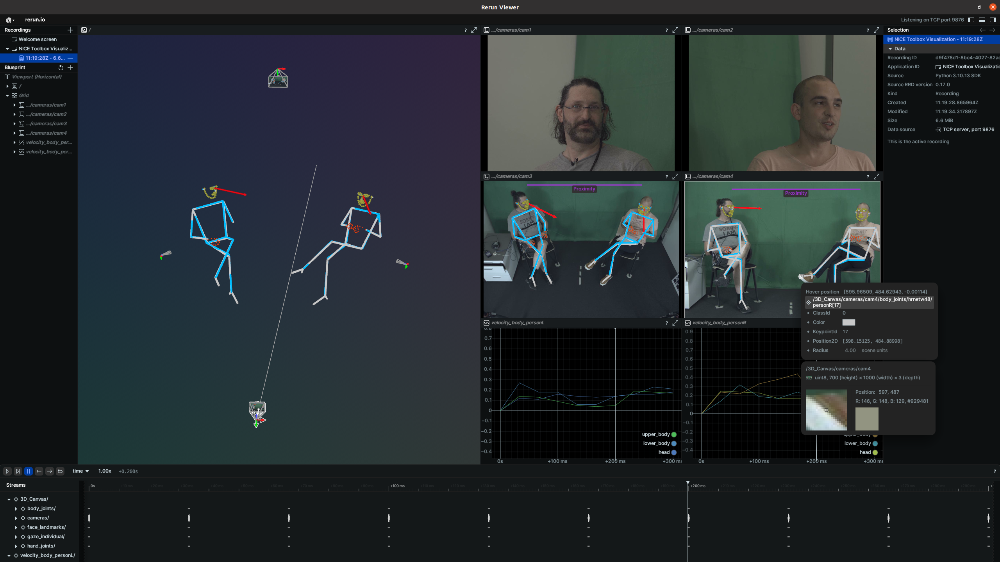
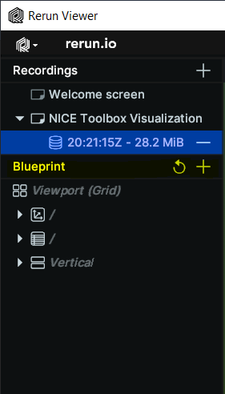
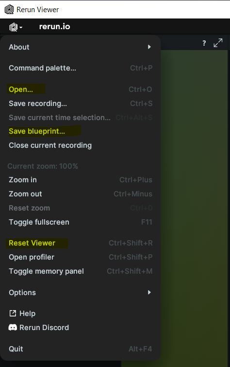

# 4. Visualizations in Rerun

This tutorial explains how to use [Rerun](https://rerun.io) for an interactive visualization of the results and predictions by the NICE Toolbox.


```{contents} Contents
:depth: 3
:local:
```


## 1. Starting Rerun

Open a command line or terminal and navigate to the top level directory of the nicetoolbox repository. Start the visualizer by running:

```bash
source ./envs/nicetoolbox/bin/activate  # Linux
envs\nicetoolbox\Scripts\activate       # Windows

run_visualization
```

It will open a window like this one:



## 2. Visualizer config

The visualizer config `./configs/visualizer_config.toml` consists of three main parts: io, media, and component specifications.

```toml
spawn_viewer = true                                                       # if true, will spawn window with GUI

[io]
dataset_folder = "<datasets_folder_path>"                                 # main dataset folder
dataset_name = 'communication_multiview'                                  # dataset of the video
video_name = 'communication_multiview_sequence_xyz_s0_l-1'                # name of video result folder
nice_tool_output_folder = "<output_folder_path>/experiments"              # NICE Toolbox experiment output
experiment_folder = "<output_folder_path>/experiments/<yyyymmdd>"         # select single NICE Toolbox experiment output folder
experiment_video_folder = "<experiment_folder>/<video_name>"              # NICE Toolbox output folder for the specific video
experiment_video_component = "<experiment_video_folder>/<cur_component_name>" # NICE Toolbox output folder for the specific component

[media]                                # each media session shows the results of one video
[media.visualize]                      # specify what will be visualized
components = ["body_joints", "hand_joints", "face_landmarks", "gaze_multiview", "gaze_interaction"]  # list of components
start_frame = 0                        # starting frame for the visualization
end_frame = -1                         # end frame for the visualization, -1 means process until the end of the video
visualize_interval = 1                 # 1 means visualize every frame; change the parameter accordingly if you want to visualize every x frames
```

By default, the visualizer opens the results of today's experiment. To open another experiment or another part of a video, change `experiment_folder` and `video_name` (see [Results and Experiments](tutorial1_configure_detectors.md#5-results-and-experiments)).

A detailed description of visualizer configuration can be found in the wiki page on config files under [visualizer config](../wikis/wiki_config_files.md#visualizer-config).


## 3. Configuring component data display in Rerun windows

You can control which data is shown in specific Rerun windows by adjusting the `media.<component>.canvas` items.
The keys (like `3d` or `2d_interpolated`) represent the different types of data provided by that component.
The value lists define which canvases (Rerun windows) show the data:

1. `3D_Canvas`: shows the data in the 3D canvas. It is only for multi-view datasets. Do not change the canvas name.
2. Cameras: shows the data on the image of that camera. The camera name must match a camera name in `dataset_properties.toml`.
3. Metrics: shows the data as plots.
4. Empty list: if you don't want the data to be visualized, leave the list empty.


### Configuring algorithm display

Under `media.<component>`, the `algorithms` parameter lets you choose which algorithms to display.
For example, if you have multiple algorithms in the `body_joints` component (e.g., `rtmw_l_wholebody` and `vitpose_huge`),
you can specify which algorithm's results to show.
If you want to see results from both algorithms, list both names.


### Configuring appearance

Under `media.<component>.appearance`, you can configure the color and radii (the size of the dots and lines).

```toml
# Component: gaze multiview - An example for 3D_Canvas and Camera Canvases
[media.gaze_multiview]
algorithms = ['gaze_per_subject']       # list of algorithms
[media.gaze_multiview.canvas]
gaze_3d_filtered = ["3D_Canvas", "view_left", "view_right", "view_top", "view_center"] ## value options: [3D_Canvas], [3D_Canvas, camera names], [camera names], []
                                                                                         ## Note: Delete '3D_Canvas' if you don't have a multi-view setup.
[media.gaze_multiview.appearance]
colors = [[0, 150, 90]]                 # define the color of the gaze arrow, one per algorithm
radii = {'3d'= 0.01, 'camera_view'= 4}  # define the size of gaze arrow in 3D_Canvas and camera views

# Component: kinematics - An example for Metrics Display
[media.kinematics]
algorithms = ['velocity_body_3d']       # or 'velocity_body_2d' for single-view setups

[media.kinematics.canvas]
velocity_bodypart_3d = ["metric_velocity"]
velocity_bodypart_2d = ["metric_velocity"]
```

The kinematics plots show the mean velocity of body parts, for example head, upper body and lower body. These body part groups are defined in `configs/predictions_mapping.toml`, not in the visualizer config.


## 4. Configuring the Rerun viewer and blueprint

When Rerun starts, it automatically creates a heuristic view for the windows.
You can manually change this by dragging the windows or adding new ones using the plus sign next to the Blueprint menu.



This Blueprint can be saved using the 'Save blueprint...' menu option and reopened later using the
'Open' option. Once you configure the Rerun viewer, it will use the same blueprint for future sessions.
You can reset the layout by clicking 'Reset Blueprint'.



If your new video does not have certain windows that the old dataset had, unused empty windows may appear.
To get a fresh heuristic layout, reset the blueprint.
