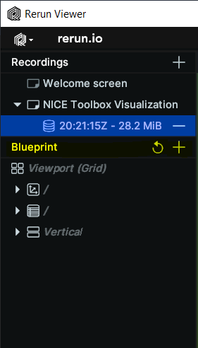
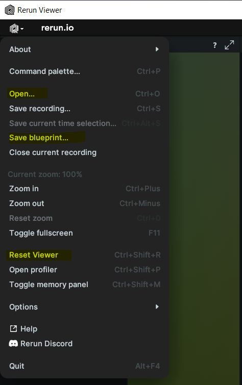

# Configuration Files

The configuration files are [TOML](https://toml.io) files. They describe the machine on which NICE Toolbox runs, the experiment to run, the data to run on, the detectors and algorithms to use, the mappings between different data identifiers, and the visualization of the results. Most of these files can contain placeholders, which are explained first.

For step-by-step guides, see the tutorials [Configure Detectors](../tutorials/tutorial1_configure_detectors.md) and [Configure Custom Dataset](../tutorials/tutorial2_include_dataset.md).

```{contents} Contents
:depth: 3
:local:
```


## Placeholders

Placeholders are names in angle brackets, for example `<output_folder_path>`. You can put them into strings, and NICE Toolbox fills them in automatically. All configs support placeholders where reasonable. A placeholder can take these values:

1. All keys in `./machine_specific_paths.toml` and `./nice_project.toml`, as well as `<project_folder_path>` (the path to the project folder passed with `--project_folder_path`).
2. All keys of the same section, for example all keys of `[io]` in `./configs/detectors_run_file.toml`.
3. The keys `<cur_dataset_name>`, `<cur_component_name>`, `<cur_algorithm_name>`, `<cur_sequence_id>`, `<cur_video_start>`, and `<cur_video_length>`. They describe the sequence, component and algorithm that run now, and are filled during the run based on the run file `./configs/detectors_run_file.toml`. In paths of one camera, for example `nicetoolbox_camera_input_folder`, `<cur_camera_name>` is the name of the camera.
4. The run information `<git_hash>`, `<commit_message>`, `<me>`, `<today>`, `<yyyymmdd>`, `<time>`, and `<pwd>`.
5. Inside a `[dataset_name.template]` block (see [dataset properties](#dataset-properties)), any user-defined key can be used in the other fields of the same sequence. For example, `dataset_root = "<datasets_folder_path>/my_dataset"` lets you write `<dataset_root>` in every path of this dataset.

Some examples:

- The default output folder in the [run file's io](#input-and-output-files) is `"<output_folder_path>/experiments/<experiment_name>"`. During the run, `<output_folder_path>` is filled from the [project config](#project-config), and `<experiment_name>` is filled from the same `[io]` section.
- A typical camera path inside a dataset template is `"<dataset_root>/<sequence_id>/view_center.mp4"`. `<dataset_root>` is a user-defined key of the template, and `<sequence_id>` is the `sequence_id` of each sequence.

## Machine specifics

The `./machine_specific_paths.toml` file contains settings specific to the machine that runs NICE Toolbox. It is part of `.gitignore` and must exist on each machine. The [installer](../installation.md#installation-script) creates it.

```toml
# Optional Hugging Face token for gated Hub models (e.g. sam_3d_body). Leave empty if unused.
hugging_face_token = ''
# Hardware acceleration for video decoding (ffmpeg '-hwaccel'), e.g. 'cuda', 'auto', 'd3d11va'.
# Set to 'none' to decode on the CPU, e.g. on machines without a usable NVIDIA GPU.
ffmpeg_hwaccel = 'cuda'
```

- `hugging_face_token` is an optional secret for the Hugging Face Hub (str). Algorithms with gated models, for example `sam_3d_body` and the `pyannote` diarization, read the token only from this field, not from environment variables. See [Hugging Face access token](../installation.md#hugging-face-access-token).
- `ffmpeg_hwaccel` selects the hardware acceleration that ffmpeg uses to decode videos, for example when it extracts frames (str, required). It is passed to ffmpeg as `-hwaccel`. Use `'cuda'` for NVIDIA GPUs, `'auto'` to let ffmpeg select a method, or `'none'` to decode on the CPU. If video decoding fails on a machine without a usable NVIDIA GPU, set it to `'none'`.


## Project config

The `./nice_project.toml` file defines the paths of a project: datasets, outputs and configs. It is part of `.gitignore`, and the [installer](../installation.md#installation-script) creates it. The `<project_folder_path>` placeholder is the absolute path of the folder passed with `--project_folder_path`.

```toml
configs_folder_path = '<project_folder_path>/configs'
datasets_folder_path = '../datasets'
output_folder_path = '../outputs'
```

- `configs_folder_path` is the path to the config folder of the project (str). It is the default location of all config files.
- `datasets_folder_path` is the path to the folder that contains all datasets (str).
- `output_folder_path` is the path to the folder where NICE Toolbox saves all results (str).

Relative paths start from the NICE Toolbox folder.

## Run file

The run file `./configs/detectors_run_file.toml` defines the experiments to run. It has four parts: general properties, the selected algorithms, the datasets and sequences, and the input and output files. The run file supports [placeholders](#placeholders).

To keep several run files, start a run with `run_detectors --run_config <file>`.


### General properties

Properties that apply to all experiments.

```toml
visualize = true
skip_inference = false
save_csv = true
save_frames = false

error_level = "DETECTOR"
log_level = "INFO"

check_missing_detectors_dependencies = true
skip_gated_models_errors = true
```

- `visualize` enables saving of visualizations for each algorithm (bool). Disable it for faster runs. Enable it for test runs on small parts of the data and for debugging. Each algorithm also has its own `visualize` setting in the [detectors config](#detectors-config). NICE Toolbox creates visualizations only if both are `true`.
- `skip_inference` skips the model inference and runs only the post-processing and visualization (bool). It reuses the native model outputs of an earlier run in the same experiment folder.
- `save_csv` enables saving all results as 2D tables in CSV files (bool).
- `save_frames` saves all frames with visualizations as images, if `visualize` is `true` (bool).
- `error_level` controls what happens when an error occurs (str). Options: `"DETECTOR"` (skip the failed algorithm), `"SEQUENCE"` (skip the failed sequence), `"STRICT"` (stop at the first error).
- `log_level` sets the logging verbosity (str). Options: `"CRITICAL"`, `"ERROR"`, `"WARNING"`, `"INFO"`, `"DEBUG"`.
- `check_missing_detectors_dependencies`, if `true`, checks before the run that all algorithms that the selected algorithms depend on are also selected (bool). Set it to `false` to reuse the results of algorithms from an earlier run.
- `skip_gated_models_errors`, if `true`, removes all algorithms that use a gated Hugging Face model (e.g. `sam_3d_body`, the `pyannote` diarization) when no `hugging_face_token` is set in `machine_specific_paths.toml` (bool). If `false`, the run stops with an error instead. Set it to `true` for test runs on machines without Hugging Face access. Set it to `false` in production to find missing tokens early.

### Choosing algorithms to run

The `algorithms` field lists the algorithm instances to run. They are defined in the [detectors config](#detectors-config). NICE Toolbox applies all listed algorithms to every dataset in the `[run]` section and runs them in the order of their dependencies.

```toml
algorithms = ["video_subject_detector", "rtmdet_m_person", "vitpose_huge", "unigaze", "gaze_per_subject", "gaze_distance_3d"]
```

If you select an algorithm, also select all algorithms that it takes input from. See [Dependencies Between Algorithms](../tutorials/tutorial1_configure_detectors.md#4-dependencies-between-algorithms).

### Defining the experiments

NICE Toolbox can process several datasets one after another in a single run.

`[run]` defines which data to process. Each key is a dataset name, and the value defines which sequences to process:

```toml
[run.dataset_name]
sequences = [
    {sequence_id = "sequence_xyz", video_start = 0, video_length = 100},
    {sequence_id = "S1_*",         video_start = 0, video_length = -1},   # wildcard: all sequences starting with "S1_"
    # ...
]
```

- `sequences` defines which sequences of the dataset to process (list of dict). Each entry selects one sequence, or a group of sequences with a wildcard. NICE Toolbox processes the entries one after another.

    - `sequence_id` selects one of the sequences of the [dataset properties](#dataset-properties) (str). It supports the glob wildcards `*`, `?` and `[...]`: `"*"` matches all sequences, and `"S1_*"` matches every ID that starts with `S1_`. An ID without wildcards must match exactly.
    - `video_start` is the start of the part to process (int or timestamp).
    - `video_length` is the length of the part to process (int or timestamp). Use `-1` for the full video.

    Both `video_start` and `video_length` accept frame numbers or timestamps:

    - **Frame-based format:**
      - `video_start`: frame number (`0` for the beginning).
      - `video_length`: number of frames. `-1` means all frames until the end of the video.
      - `video_start` + `video_length` must not exceed the total frame count.

    - **Timestamp format:**
      - Accepts `HH-MM-SS`, `HH-MM-SS.mmm`, `HH:MM:SS` or `HH:MM:SS.mmm`.
      - Examples:
        - `00:01:12.100`: 1 minute, 12 seconds and 100 milliseconds.
        - `00-05-30`: 5 minutes and 30 seconds.
      - `video_start` + `video_length` must not exceed the video duration.

```{note}
Every sequence in `dataset_properties.toml` has a unique `sequence_id`. This ID addresses one recording, with all its video and audio tracks. `video_start` and `video_length` select a part of this recording.
```


### Input and output files

The last part of the run file defines where NICE Toolbox finds its inputs and saves its outputs.

```toml
[io]
experiment_name = "<yyyymmdd>"
out_folder = "<output_folder_path>/experiments/<experiment_name>"
out_sub_folder_name = "<cur_dataset_name>_<cur_sequence_id>_s<cur_video_start>_l<cur_video_length>"
out_sub_folder = "<out_folder>/<out_sub_folder_name>"
csv_out_folder = "<out_sub_folder>/_csv_files"
nicetoolbox_input_folder = "<output_folder_path>/nicetoolbox_input/<cur_dataset_name>_<cur_sequence_id>"
nicetoolbox_camera_input_folder = "<nicetoolbox_input_folder>/<cur_camera_name>"
code_folder = "<pwd>"
assets = "<code_folder>/nicetoolbox/detectors/assets"
asset_manifest = "<code_folder>/configs/asset_manifest.toml"
dataset_properties = "<configs_folder_path>/dataset_properties.toml"
detectors_config = "<configs_folder_path>/detectors_config.toml"
predictions_mapping = "<configs_folder_path>/predictions_mapping.toml"
detector_result_folder = "<out_sub_folder>/<cur_component_name>"
detector_additional_results_folder = "<detector_result_folder>/<cur_algorithm_name>"
detector_visualization_folder = "<detector_additional_results_folder>/visualization/"
detector_native_folder = "<out_sub_folder>/_native_outputs/<cur_algorithm_name>"
detector_native_out_folder = "<detector_native_folder>/detector_output"
detector_native_visualization_folder = "<detector_native_folder>/visualization"
detector_run_config_path = "<detector_native_folder>"

[io.frame_extraction]
frame_extension = ".jpg"     # Options: ".jpg", ".jpeg", ".png"
compression_quality = 2      # .jpg/.jpeg only: 1 to 31, lower means higher quality
```

- `experiment_name` is the name of the experiment (str). The default is today's date in the format YYYYMMDD. All runs with the same name save their results in the same folder.
- `out_folder` is the top-level folder where NICE Toolbox saves the results of the experiment (str).
- `out_sub_folder_name` is the folder name for one processed part of a sequence (str).
- `out_sub_folder` is the full path of this folder (str).
- `csv_out_folder` is where NICE Toolbox saves the CSV files (str).
- `nicetoolbox_input_folder` is the folder where NICE Toolbox saves the pre-processed input data (str). Different algorithms need different file formats and folder structures as input, so NICE Toolbox prepares the data for them. It keeps this data to make later runs on the same data faster.
- `nicetoolbox_camera_input_folder` is the pre-processed input folder of one camera (str), for example the extracted video frames. `<cur_camera_name>` is the name of the camera. Change it to read the frames of a camera from another folder.
- `code_folder` is the path to the NICE Toolbox folder on this machine (str). It is filled automatically.
- `assets` is the folder of additional assets, like model checkpoints and weights (str).
- `asset_manifest` is the path to the asset manifest, which lists the model weights to download (str). This file is part of the NICE Toolbox installation, not of the project.
- `dataset_properties`, `detectors_config`, and `predictions_mapping` are the paths to these config files (str). All default to the `<configs_folder_path>` of the project.
- `detector_result_folder`, `detector_additional_results_folder`, and `detector_visualization_folder` define where each algorithm saves its final results, additional results, and visualizations (str). The final results of all components and algorithms of a detector are in `detector_result_folder`.
- `detector_native_folder`, `detector_native_out_folder`, `detector_native_visualization_folder`, and `detector_run_config_path` define where method detectors save their native outputs (from external environments) and run configs (str).
- `[io.frame_extraction]` defines the image format of the frames that NICE Toolbox extracts from the videos:
    - `frame_extension` is `".jpg"` or `".jpeg"` (default) for smaller files and faster extraction, or `".png"` for lossless frames, which need more disk space and time.
    - `compression_quality` (JPEG only) is the quality, from `1` to `31`. Lower values give a higher quality.
    - `compression_level` (PNG only) is the compression, from `0` to `9`. Higher values give smaller files, but a slower extraction.

## Dataset properties

`./configs/dataset_properties.toml` describes your datasets. Each dataset is a **flat list of sequences**. Every sequence describes itself: it has its own cameras, audio tracks, subjects, and annotation paths. So sequences of the same dataset can differ, for example when a camera or an audio track is missing.

To avoid repeating the same fields in every sequence, each dataset can define a **template**. NICE Toolbox merges the template into every sequence. For large datasets, a **discovery pattern** can find the sequences on disk, so you do not need to list them.

### Minimal shape

```toml
[dataset_name]
sequences = [{sequence_id = "sequence_xyz"}]

[dataset_name.template]
dataset_root         = "<datasets_folder_path>/dataset_name"
data_input_folder    = "<dataset_root>/<sequence_id>"
path_to_calibrations = "<dataset_root>/calibrations.npz"
subjects             = ["person_left", "person_right"]

[dataset_name.template.video.cameras]
view_center.path = "<data_input_folder>/view_center.mp4"
view_center.subjects.rule = "vsplit"                       # left half: person_left, right half: person_right
view_center.subjects.order = ["person_left", "person_right"]

view_left.path = "<data_input_folder>/view_left.mp4"
view_left.subjects.rule = "assign"                         # the whole image shows person_left
view_left.subjects.subject = "person_left"
```

**Top-level keys per dataset**

- `sequences`: list of sequence entries (list of dict). Each entry needs at least a `sequence_id`. Any other sequence field set here replaces the field of the template.
- `template`: fields that NICE Toolbox merges into every sequence entry before validation (dict, optional). Keys can be sequence fields (`subjects`, `video`, ...) *or* user-defined placeholder keys (`dataset_root`, `data_input_folder`, ...) that you use in other strings.
- `discover_sequences`: a path pattern that finds sequences on disk when the config is loaded (str, optional). See [Filesystem discovery](#filesystem-discovery).

**Sequence fields**

- `sequence_id`: unique name of the sequence within the dataset (str, required).
- `subjects`: names of the people in the recording (list of str, required).
- `path_to_calibrations`: path to the camera calibration `.npz` file (str, optional). Set it to `""` if you have no calibration.
- `video.cameras`: named cameras (dict of `camera_name → {path, subjects}`).
    - `path` is the path to the video file. It can contain one `*` wildcard, which must match exactly one file.
    - `subjects` is a subject rule. It defines which part of the image shows which person, for example `vsplit`, `hsplit`, `assign` or `bbox`. See the [subject rules wiki](wiki_subject_rules.md#video-rules).
- `audio.tracks`: named audio tracks (dict of `track_name → {...}`). Each track comes either from a camera video (`camera = "<camera_name>"`) or from a separate audio file (`path = "..."`), not from both.
    - `stream` selects an audio stream of the source file (int, default `0`).
    - `channel` selects one channel, for example of a stereo file (int, optional). If it is not set, the audio algorithms get all channels.
    - `subjects` defines whose voice is on the track. See the [subject rules wiki](wiki_subject_rules.md#audio-rules).
- `annotation.components`: ground-truth files for the evaluation, one for each component (dict of `component_name → {path}`). See the [evaluation tutorial](../tutorials/tutorial5_evaluation.md#example-with-ground-truth-annotations).

**Placeholder keys inside the template**

Any key in the template that is not a sequence field (e.g. `dataset_root`, `data_input_folder`, `annotations_folder`) becomes a placeholder that you can use in other strings of the dataset. NICE Toolbox resolves them separately for each sequence. So `<sequence_id>` in a template string becomes the ID of *that* sequence. No runtime placeholder is necessary.

**Example.** Given this config:

```toml
[my_dataset]
sequences = [
    {sequence_id = "S1"},
    {sequence_id = "S2"},
]

[my_dataset.template]
dataset_root = "<datasets_folder_path>/my_dataset"    # user-defined key
data_input_folder = "<dataset_root>/<sequence_id>"    # uses dataset_root and sequence_id
path_to_calibrations = "<dataset_root>/calibrations.npz"
subjects = ["person_left", "person_right"]

[my_dataset.template.video.cameras]
view_1.path = "<data_input_folder>/view_1.mp4"
view_1.subjects.rule = "vsplit"
view_1.subjects.order = ["person_left", "person_right"]
```

NICE Toolbox merges the template into each sequence, then resolves the placeholders with the fields of this sequence. After loading, sequence `S1` has:

```
dataset_root         = "/abs/path/to/datasets/my_dataset"
data_input_folder    = "/abs/path/to/datasets/my_dataset/S1"
path_to_calibrations = "/abs/path/to/datasets/my_dataset/calibrations.npz"
video.cameras.view_1.path = "/abs/path/to/datasets/my_dataset/S1/view_1.mp4"
```

Sequence `S2` gets the same values, with `S2` instead of `S1`. The placeholders come from different places: `<datasets_folder_path>` comes from the project config, `<dataset_root>` and `<data_input_folder>` are user-defined keys of the same sequence, and `<sequence_id>` is the `sequence_id` of the sequence. NICE Toolbox resolves all of them when it loads the config, not during the run.

### Template merge

The template merge works on **top-level keys** only. If the template and a sequence entry define the same top-level key, the value of the sequence entry replaces the full value of the template. The merge does not go deeper.

For example, if a sequence entry defines `video`, it replaces the whole `video` block of the template, with all its cameras. To change one camera of a sequence, copy all cameras of the template into the sequence entry.

### Filesystem discovery

`discover_sequences` finds sequence folders or files on disk when the config is loaded. Each named wildcard `[name]` matches one folder or file name and saves it as a placeholder. Normal `<placeholders>` are resolved first. Unnamed wildcards like `*` are not allowed.

```toml
[dataset_name]
discover_sequences = "<datasets_folder_path>/dataset_name/[sequence_id]"

[dataset_name.template]
dataset_root      = "<datasets_folder_path>/dataset_name"
data_input_folder = "<dataset_root>/<sequence_id>"
...
```

**Example.** Suppose the dataset folder contains:

```
/abs/path/to/datasets/dataset_name/
├── S1/
├── S2/
└── S3/
```

Discovery turns the pattern `<datasets_folder_path>/dataset_name/[sequence_id]` into three sequence entries, one for each matching folder. The matched name becomes the `sequence_id`:

```
sequences = [
    {sequence_id = "S1"},
    {sequence_id = "S2"},
    {sequence_id = "S3"},
]
```

Each entry then goes through the same template merge, so `data_input_folder` of `S1` becomes `/abs/path/to/datasets/dataset_name/S1`, and so on.

```{important}
The pattern matches files as well as folders. In the example above, a file such as `calibrations.npz` in `dataset_name/` also becomes a sequence. Keep only the sequence folders in the folder of the pattern, or put the other files somewhere else.
```

**Multiple captures.** A pattern can contain more than one `[name]`, e.g. `.../[capture_id]/[take]`:

```
/abs/path/to/datasets/dataset_name/
├── day1/
│   ├── take_A/
│   └── take_B/
└── day2/
    └── take_A/
```

Discovery creates three entries, one for each matched path. Each entry contains both captures:

```
sequences = [
    {capture_id = "day1", take = "take_A"},
    {capture_id = "day1", take = "take_B"},
    {capture_id = "day2", take = "take_A"},
]
```

These entries have no `sequence_id` yet, so compose one in the template:

```toml
[dataset_name.template]
sequence_id = "<capture_id>_<take>"    # → "day1_take_A", "day1_take_B", "day2_take_A"
data_input_folder = "<dataset_root>/<capture_id>/<take>"
```

Two named wildcards must not follow each other directly. Put a separator between them, for example `[day]_[take]`.

### Combining discovery with explicit sequences

You can use `discover_sequences` and `sequences` in the same dataset. This is useful when most sequences follow the template, but some need other settings, for example an extra annotation file or other cameras.

**How the merge works.** When the config is loaded, NICE Toolbox builds the sequence list in this order:

1. It runs `discover_sequences` and creates one entry for each matched path.
2. For each entry in `sequences`:
   - If its `sequence_id` matches a discovered entry, its fields replace the fields of the discovered entry.
   - If its `sequence_id` does not match a discovered entry, NICE Toolbox adds it to the list as a new sequence.
3. It merges the template into every entry, as described in [Template merge](#template-merge).

Both merges work on top-level keys only. A sequence entry that defines `video` replaces the whole `video` block of the template.

**Example.** Discovery finds `S1`, `S2` and `S3` on disk. `S2` has a calibration file of its own, `S3` was recorded with the center camera only, and `S4_manual` is in another folder:

```toml
[dataset_name]
discover_sequences = "<datasets_folder_path>/dataset_name/[sequence_id]"

# S2 exists on disk: replace only its calibration file
[[dataset_name.sequences]]
sequence_id = "S2"
path_to_calibrations = "<dataset_root>/calibrations_S2.npz"

# S3 exists on disk: replace its full video block, so it has only view_center
[[dataset_name.sequences]]
sequence_id = "S3"
[dataset_name.sequences.video.cameras]
view_center.path = "<data_input_folder>/view_center.mp4"
view_center.subjects.rule = "vsplit"
view_center.subjects.order = ["person_left", "person_right"]

# S4_manual does not match a discovered folder: it is added as a new sequence
[[dataset_name.sequences]]
sequence_id = "S4_manual"
data_input_folder = "<dataset_root>/extra/S4"

[dataset_name.template]
# ... shared template as before ...
```

The resulting sequence list is `[S1, S2, S3, S4_manual]`. `S1` takes all its fields from the template. `S2`, `S3` and `S4_manual` take all fields from the template except the top-level fields that their entries define.

**When to use this.** Use this approach when most sequences are the same and only a few are different. It scales better than listing every sequence by hand, and it keeps the exceptions next to the rule.

## Detectors config

`./configs/detectors_config.toml` defines the algorithm instances. Each `[algorithms.<name>]` block defines one named instance that you can select in the `algorithms` list of the run file.

```toml
[algorithms.vitpose_huge]
algorithm_type = "mmpose_2d"
components = ["body_joints"]
env_name = "openmmlab"
camera_names = "*"                     # all cameras of the sequence, or a list such as ["view_top", "view_center"]
pose_config = "td-hm_ViTPose-huge_8xb64-210e_coco-256x192"
...
[algorithms.vitpose_huge.inputs]
person_bboxes = { component = "person_bounding_box", algorithm = "rtmdet_m_person", npz_key = "bbox_2d" }
[algorithms.vitpose_huge.required_assets]
pose_checkpoint = "<assets>/mmpose/td-hm_ViTPose-huge_8xb64-210e_coco-256x192-e32adcd4_20230314.pth"

[algorithms.unigaze]
algorithm_type = "unigaze"
camera_names = "*"
env_name = "unigaze"
...
[algorithms.unigaze.inputs]
subjects = { component = "subject_regions", algorithm = "video_subject_detector", npz_key = "regions" }
```

- `algorithm_type` selects the method (str). Several instances can use the same `algorithm_type` with different parameters.
- `components` lists the components that the instance produces (list of str), if the method can produce more than one.
- `camera_names` selects the cameras that the instance uses (str or list of str). `"*"` selects all cameras of the sequence. The names must match the cameras in the [dataset properties](#dataset-properties).
- `env_name` is the virtual environment in which the model runs (str).
- `inputs` defines the results of other algorithms that the instance uses. Each input names a `component`, the `algorithm` that produces it, and the `npz_key` of the array to read. The selected algorithms must be in the `algorithms` list of the run file.
- `required_assets` lists the model files that the instance needs. NICE Toolbox downloads them with the asset manifest.

All other fields are parameters of the method. The comments in the default file and the [algorithms wiki](wiki_algorithms.md) describe them.

The `[subject_assignment.video]` and `[subject_assignment.audio]` sections at the end of the file contain the settings of the [video](wiki_subject_rules.md#video-rules) and [audio](wiki_subject_rules.md#audio-rules) subject rules:

```toml
[subject_assignment.video]
min_overlap = 0.35        # discard any detection with geometric score smaller than threshold
confidence_weight = 0.1   # how important confidence comparing to geometric score

[subject_assignment.audio]
min_overlap = 0.3         # a speaker must cover at least this fraction of a subject's pinned range to get its identity
```

### Templates

Templates define shared fields that algorithm instances can inherit, to avoid repetition. You declare them under `[templates.<name>]` and use them with `template = "<name>"`.

```toml
[templates.mmpose_2d_template]
algorithm_type = "mmpose_2d"
env_name = "openmmlab"
camera_names = "*"
min_detection_confidence = 0.5
...
[templates.mmpose_2d_template.inputs]
person_bboxes = { component = "person_bounding_box", algorithm = "rtmdet_m_person", npz_key = "bbox_2d" }

[algorithms.hrnetw48]
template = "mmpose_2d_template"
components = ["body_joints", "hand_joints", "face_landmarks"]
pose_config = "td-hm_hrnet-w48_dark-8xb32-210e_coco-wholebody-384x288"
```

Algorithm fields always replace template fields. For example, `min_detection_confidence = 0.3` below replaces `0.5` from the template:

```toml
[algorithms.hrnetw48_low_conf]
template = "mmpose_2d_template"
components = ["body_joints"]
min_detection_confidence = 0.3   # replaces 0.5 from the template
...
```

Like the dataset template, this merge works on top-level keys only. If an algorithm defines its own `inputs` table, it replaces the full `inputs` table of the template. So define all inputs in it, not only the input that you change.

Templates can inherit from other templates:

```toml
[templates.mmpose_2d_template]
algorithm_type = "mmpose_2d"
env_name = "openmmlab"
camera_names = "*"
...

[templates.hrnetw48_template]
template = "mmpose_2d_template"
components = ["body_joints", "hand_joints", "face_landmarks"]
pose_config = "td-hm_hrnet-w48_dark-8xb32-210e_coco-wholebody-384x288"

[algorithms.hrnetw48_low_conf]
template = "hrnetw48_template"
min_detection_confidence = 0.3

[algorithms.hrnetw48_high_conf]
template = "hrnetw48_template"
min_detection_confidence = 0.8
```

For a step-by-step guide to parameters, templates and custom algorithm instances, see [Configure Detectors](../tutorials/tutorial1_configure_detectors.md#7-advanced-configuration).


## Predictions mapping

`./configs/predictions_mapping.toml` contains mappings between different data identifiers. These are, for example, different conventions for selecting and naming human body joints, also called keypoints. For each format, for example `coco_wholebody`, the file defines:

- the keypoint names and their indices,
- the connections between keypoints, which the `bone_length` evaluation metric uses,
- the body part groups such as `head` or `upper_body`, which the kinematics algorithms and their plots use.

Algorithms select a format with `keypoint_mapping`. Usually you do not need to change this file.


## Visualizer config

`./configs/visualizer_config.toml` defines what the [Rerun](https://rerun.io) viewer shows. It has three main parts: io, media, and the component settings.

```toml
spawn_viewer = true                                                       # if true, will spawn window with GUI

[io]
dataset_folder = "<datasets_folder_path>"                                 # main dataset folder
dataset_name = 'communication_multiview'                                  # dataset of the video
video_name = 'communication_multiview_sequence_xyz_s0_l-1'                # name of video result folder
nice_tool_output_folder = "<output_folder_path>/experiments"              # NICE Toolbox experiment output
experiment_folder = "<output_folder_path>/experiments/<yyyymmdd>"         # select single NICE Toolbox experiment output folder
experiment_video_folder = "<experiment_folder>/<video_name>"              # NICE Toolbox output folder for the specific video
experiment_video_component = "<experiment_video_folder>/<cur_component_name>" # NICE Toolbox output folder for the specific component

[media]                                # each media session shows the results of one video
[media.visualize]                      # specify what will be visualized
components = ["body_joints", "hand_joints", "face_landmarks", "gaze_multiview", "gaze_interaction"]  # list of components
start_frame = 0                        # starting frame for the visualization
end_frame = -1                         # end frame for the visualization, -1 means process until the end of the video
visualize_interval = 1                 # 1 means visualize every frame; change the parameter accordingly if you want to visualize every x frames
```

- `spawn_viewer` opens the viewer window (bool).
- `experiment_folder` and `video_name` select the results to show. By default, the viewer shows the results of today's experiment.
- `components` lists the components to show.

### Configuring component data display in Rerun windows

You can control which data is shown in specific Rerun windows by adjusting the `media.<component>.canvas` items. The keys (like `3d` or `2d_interpolated`) represent the different types of data provided by that component. The value lists define which canvases (Rerun windows) show the data:

1. `3D_Canvas`: shows the data in the 3D canvas. It is only for multi-view datasets. Do not change the canvas name.
2. Cameras: shows the data on the image of that camera. The camera name must match a camera name in `dataset_properties.toml`.
3. Metrics: shows the data as plots.
4. Empty list: if you don't want the data to be visualized, leave the list empty.

**Configuring algorithm display**

Under `media.<component>`, the `algorithms` parameter lets you choose which algorithms to display. For example, if you have multiple algorithms in the `body_joints` component (e.g., `rtmw_l_wholebody` and `vitpose_huge`), you can specify which algorithm's results to show. If you want to see results from both algorithms, list both names.

**Configuring appearance**

Under `media.<component>.appearance`, you can configure the color and radii (the size of the dots and lines).

```toml
# Component: gaze multiview - An example for 3D_Canvas and Camera Canvases
[media.gaze_multiview]
algorithms = ['gaze_per_subject']       # list of algorithms
[media.gaze_multiview.canvas]
gaze_3d_filtered = ["3D_Canvas", "view_left", "view_right", "view_top", "view_center"] ## value options: [3D_Canvas], [3D_Canvas, camera names], [camera names], []
                                                                                         ## Note: Delete '3D_Canvas' if you don't have a multi-view setup.
[media.gaze_multiview.appearance]
colors = [[0, 150, 90]]                 # define the color of the gaze arrow, one per algorithm
radii = {'3d'= 0.01, 'camera_view'= 4}  # define the size of gaze arrow in 3D_Canvas and camera views

# Component: kinematics - An example for Metrics Display
[media.kinematics]
algorithms = ['velocity_body_3d']       # or 'velocity_body_2d' for single-view setups

[media.kinematics.canvas]
velocity_bodypart_3d = ["metric_velocity"]
velocity_bodypart_2d = ["metric_velocity"]
```

The kinematics plots show the mean velocity of body part groups, for example head, upper body and lower body. These groups are defined in the [predictions mapping](#predictions-mapping), not in the visualizer config.

### Configuring the Rerun viewer and blueprint

When Rerun starts, it automatically creates a heuristic view for the windows. You can change this manually by dragging the windows or adding new ones with the plus sign next to the Blueprint menu.



You can save this blueprint with the `Save blueprint...` menu option and open it again later with the `Open` option. Once you configure the Rerun viewer, it uses the same blueprint for future sessions. You can reset the layout by clicking `Reset Blueprint`.



If your new video does not have certain windows that the old dataset had, unused empty windows may appear. To get a fresh heuristic layout, reset the blueprint.


## Evaluation config

`./configs/evaluation_config.toml` defines the evaluation metrics. The top-level fields select the experiment to evaluate and the output folder, and each `[metrics.<name>]` section defines one metric instance. See the [evaluation tutorial](../tutorials/tutorial5_evaluation.md) and the [evaluation metrics wiki](wiki_evaluation_metrics.md).


## Connector configs

The files in `./configs/connectors/` define the tasks of the ELAN and napari-DeepLabCut connectors, one file for each task. See the [connectors wiki](wiki_connectors.md).
