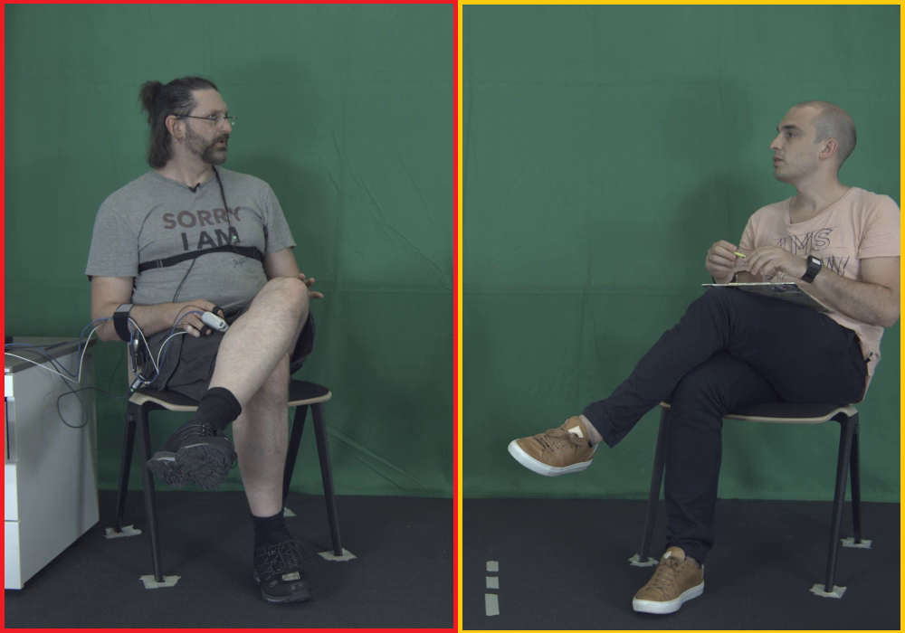

# Subject Rules

NICE Toolbox assigns every result to a named **subject**, for example to the `client` or the `therapist` of a therapy session. A **subject rule** tells NICE Toolbox which part of a camera image or which part of an audio track belongs to which subject. Each camera and each audio track in `configs/dataset_properties.toml` has one rule in its `subjects` setting:

```toml
view_1.subjects.rule = "vsplit"                  # the rule
view_1.subjects.order = ["client", "therapist"]  # the settings of the rule
```

Every name in a rule must also be in the `subjects` list of the sequence. For a step-by-step introduction, see [include your own dataset](../tutorials/tutorial2_include_dataset.md).

```{contents} Contents
:depth: 2
:local:
```

## Video Rules

The algorithm `video_subject_detector` applies the video rules and saves a **subject region** for each subject, camera and frame. NICE Toolbox assigns each detected person to the subject whose region contains the largest part of the detection.



### vsplit

Splits the image into vertical strips, from left to right, one for each name in `order`. Use it when people sit next to each other.

- `order`: the subject names, from left to right.
- `ratio` (optional): the width of the strips. By default, all strips have the same width. For two subjects, `ratio = 0.4` gives the first subject 40 % of the width. For more subjects, give one relative value for each subject, for example `[0.3, 0.5]`.

```toml
view_center.subjects.rule = "vsplit"
view_center.subjects.order = ["client", "therapist"]
```

### hsplit

Splits the image into horizontal bands, from top to bottom. Use it when people are above each other in the image. It has the same settings as `vsplit`.

```toml
view_top.subjects.rule = "hsplit"
view_top.subjects.order = ["client", "therapist"]
```

### assign

Gives the whole image to one subject. Use it for a camera that shows only one person, for example a close-up camera.

- `subject`: the subject name.

```toml
view_client.subjects.rule = "assign"
view_client.subjects.subject = "client"
```

### bbox

Gives each subject a fixed rectangle. Use it when people stay in one place, but a split does not fit.

- `boxes`: one `[x0, y0, x1, y1]` rectangle in pixels for each subject. `x0, y0` is the top-left corner. A subject without a box is not in this camera.

```toml
view_top.subjects.rule = "bbox"
view_top.subjects.boxes.client = [0, 100, 600, 1080]
view_top.subjects.boxes.therapist = [1300, 100, 1920, 1080]
```

### path

Reads the subject regions for each frame from an `.npz` file. Use it when people move around. You can also use the `subject_regions` result of an earlier run.

- `source`: path to the `.npz` file. It must contain the key `regions`, with one `[x0, y0, x1, y1]` box for each subject, camera and frame. Its frame count must match the processed part of the video. `NaN` marks a subject that is not visible.

```toml
view_center.subjects.rule = "path"
view_center.subjects.source = "<dataset_root>/regions/<sequence_id>.npz"
```

### none

Gives no region to any subject. Use it for a camera that shows nobody whom you want to analyze.

```toml
view_room.subjects.rule = "none"
```

### Video Settings

Section `[subject_assignment.video]` in `configs/detectors_config.toml`:

| Setting | Default | What it does |
|---------|---------|--------------|
| `min_overlap` | `0.35` | The smallest part of a detection box that must be inside a subject region |
| `confidence_weight` | `0.1` | How much the detection confidence counts, compared to the overlap |

## Audio Rules

The algorithm `audio_subject_detector` applies the audio rules and saves the `audio_diarization` component: for each track, the times in which each subject speaks. Transcription algorithms such as `whisperx` use it to assign each word to a subject.

### assign

Gives the whole track to one subject. Use it for a microphone that records only one person.

- `subject`: the subject name.

```toml
mic_client.subjects.rule = "assign"
mic_client.subjects.subject = "client"
```

### audio_range

Separates several voices on one track with a speaker diarization algorithm. Use it for a microphone that records several people. Also add the diarization algorithm to the `algorithms` list of the run file.

- `algorithm`: the diarization algorithm, for example `pyannote`.
- `ranges`: for each subject, a list of time ranges in which only this subject speaks. `start` and `stop` are timestamps (`HH:MM:SS.mmm`) or frame numbers from the start of the recording. Ranges of different subjects must not overlap.

```toml
room.subjects.rule = "audio_range"
room.subjects.algorithm = "pyannote"
room.subjects.ranges.therapist = [{start = "00:00:00", stop = "00:00:02"}]
room.subjects.ranges.client = [{start = "00:00:04", stop = "00:00:05"}]
```

NICE Toolbox gives each voice the name of the subject whose ranges it covers most.

### path

Reads the speaker times from a JSON file in the `audio_diarization` format. Use it when you already know who speaks when, for example from a manual annotation.

- `source`: path to the JSON file. The speaker names in the file must be subject names.
- `track`: the track name in the file.

```toml
room.subjects.rule = "path"
room.subjects.source = "<dataset_root>/diarization/<sequence_id>.json"
room.subjects.track = "room"
```

### none

Gives no speaker times to any subject. Use it for a track that records nobody whom you want to analyze.

```toml
room.subjects.rule = "none"
```

### Audio Settings

Section `[subject_assignment.audio]` in `configs/detectors_config.toml`:

| Setting | Default | What it does |
|---------|---------|--------------|
| `min_overlap` | `0.3` | The smallest part of a subject's ranges that a voice must cover to get the subject's name |
